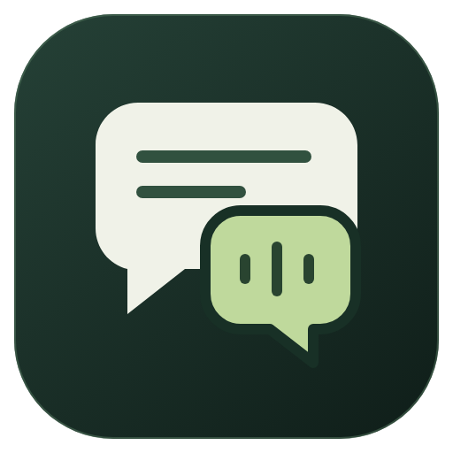
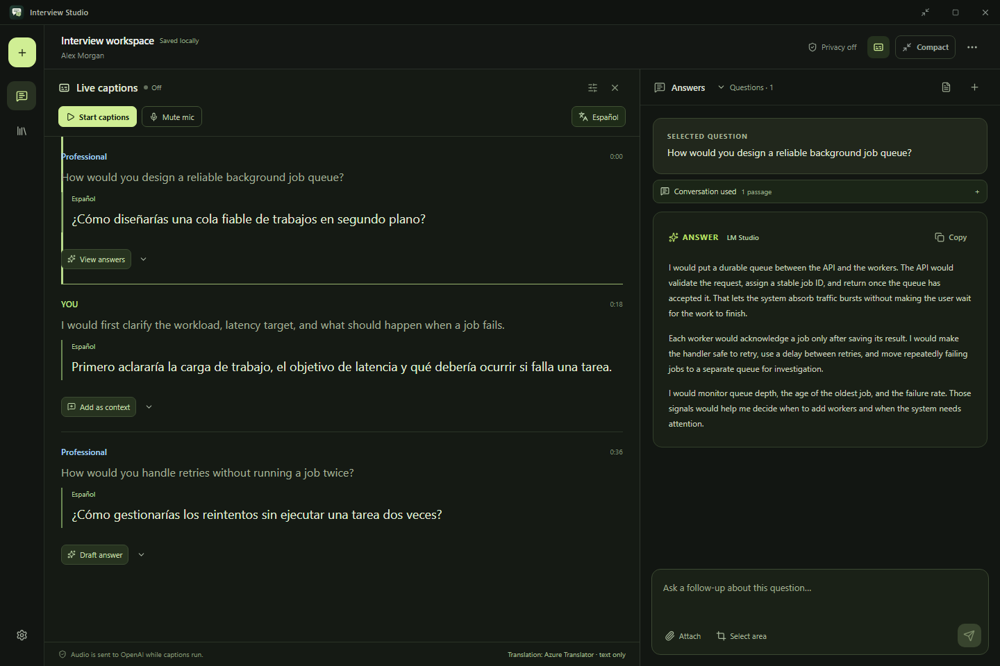
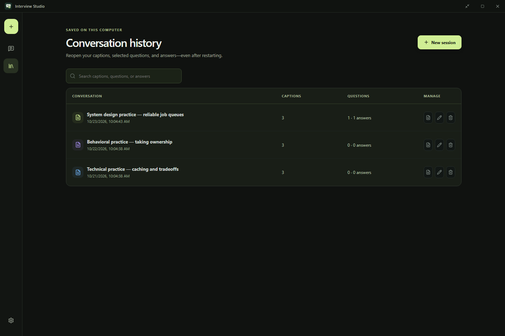

<p align="center">
  
</p>

# Interview Studio

**Follow the conversation. Find the right words. Keep the context.**

Interview Studio is a Windows desktop workspace for interview practice and sessions where AI assistance is permitted. It brings live captions, translation, contextual Q&A, and conversation history into one place, helping you turn a question into a clear answer you can say naturally.

Use your own OpenAI, OpenRouter, or NanoGPT credentials, or connect to a local model through LM Studio. The interview workspace requires no app account or shared subscription.



*Current desktop UI with fictional practice data. These screenshots use saved sample conversations; they do not involve live recording or hosted AI requests.*

[Features](#what-you-can-do) · [Getting started](#getting-started) · [Providers](#choose-your-providers) · [History](#return-to-any-conversation) · [Privacy](#privacy-and-data) · [User guide](docs/USER_GUIDE.md)

## What you can do

| Feature | How it helps |
| --- | --- |
| **Live captions** | Read microphone and computer audio in the main panel. **YOU** labels microphone input; **Professional** labels computer audio. |
| **Bilingual captions** | Choose a target language and see the translation alongside the original speech. |
| **Question-linked answers** | Draft an answer from a caption, highlight a specific passage, or type your own question. Follow-ups stay in that question's thread. |
| **Natural speaking style** | Get plain-text responses with easy words and clear paragraphs. Behavioral answers can use STAR when the supplied experience supports it. |
| **Your profile and target job** | Add a resume, experience, job description, and company context to make answers more relevant. |
| **Screenshot references** | Attach image files, choose screen/window snapshots, or drag an area to add a crop. Preview and remove attachments before sending. |
| **Saved-provider recovery** | If credits or quota interrupt Q&A, try another configured provider while preserving the question and keeping partial answers separate. |
| **Conversation history** | Reopen captions, translations, selected questions, answers, and drafts. Search, rename, export, or delete a session. |
| **Flexible workspace** | Use the full layout, compact view, or an always-on-top floating bar while the session continues. |

## From conversation to answer

1. **Set your context.** Choose an AI connection and optionally add a candidate profile and target job in Settings.
2. **Start deliberately.** Begin a fresh session. Type a question immediately, or select the audio sources and start captions when appropriate.
3. **Choose the question.** Click **Draft answer** on Professional speech, highlight a passage for **Draft selection**, or add speech as context before sending.
4. **Continue the discussion.** Ask a follow-up in the same thread, copy the answer, or switch to another saved question without losing your place.
5. **Review later.** Open Conversation history to revisit the full transcript and answers, or export a text/Markdown copy.

New launches open an empty session. Older conversations stay available in history and open only when you select them. Starting the app does not start the desktop workspace's caption recording or a model request.

## Choose your providers

Chat, transcription, and translation are configured separately in **Settings → AI connection**.

| Service | Interview Q&A | Caption transcription | Caption translation |
| --- | --- | --- | --- |
| OpenAI | Yes | Yes | Yes |
| OpenRouter | Yes | Yes | Yes |
| NanoGPT | Yes | — | Yes |
| LM Studio | Yes, with a local model | — | Yes, with a suitable local model |
| Azure Translator | — | — | Yes |
| Google Cloud Translation | — | — | Yes |
| Offline models | Through LM Studio | English speech pack | English-to-target language packs |

Hosted services require your own credentials and may charge for usage. Available models, image support, translation quality, and latency depend on the selected service and model. The app does not provide API credits or guarantee a free translation allowance.

For local processing, install the offline English caption pack, download the translation packs you need, and use LM Studio for Q&A. Downloads require internet; installed models can run locally. Offline transcription currently supports English, and offline translation packs translate from English into supported target languages.

### When a provider runs out of credits

Q&A can automatically switch to another saved, configured provider after a credit or quota failure. Each alternative uses its saved model and receives the same question, selected context, profile, and attachments. The answer shows which provider is being used; your preferred provider stays unchanged.

Interrupted text remains available as a previous partial answer. If no alternative is configured, or every alternative fails, the app shows a clear error with recovery controls. **Stop** cancels the attempt chain. This Q&A recovery does not change the independent caption and translation provider rules.

## Getting started

### Requirements

- Windows 10 or 11.
- Node.js 22 or newer and npm for running from source.
- A configured hosted provider, or LM Studio with a loaded local model, for real AI answers.
- A microphone and/or computer-audio source if you want live captions. Typed Q&A works without starting audio capture.

### Run from source

```powershell
npm install
npm run dev
```

Then open **Settings → AI connection**, select your provider, enter its key or local server details, and choose a model. Use **Test connection** to check the saved setup. When credentials have been edited, **Save & test connection** saves and tests those changes with progress and result feedback.

To compile the desktop workspace and preview it:

```powershell
npm run build
npm run preview
```


### Configure captions and translation

1. In **Settings → AI connection → Caption transcription**, choose OpenAI, OpenRouter, or Offline. Download the caption pack if you choose Offline.
2. Open **Caption options** to choose microphone, computer audio, or both. Use **Start captions**, **Pause**, **Stop**, and **Mute mic** as needed.
3. Configure **Caption translation** independently, then choose a target language in the caption panel. Offline target packs download only when explicitly requested.

Use a headset when possible. PC speaker playback can enter the microphone and appear as YOU. The source labels identify audio inputs, not individual people; there is no voice identification or diarization.

## Return to any conversation

History keeps the transcript and its translations together with question threads and their answers. Reopening an existing answer does not generate another model response. An explicit retry or new question can make a new request.



For longer sessions, the desktop app builds a bounded local summary from original speech excerpts and retrieves relevant earlier passages when you ask a question. It sends selected context rather than the whole transcript on every request. This reduces repeated history input; it does not guarantee perfect recall, a fixed token bill, or uninterrupted multi-hour recording.


## Privacy and data

These statements apply to the **Electron interview workspace**.

- **Hosted processing:** questions, selected context, active profile details, and attached images go to the configured Q&A provider when sent. Hosted captions upload selected audio while captions run. Hosted translation sends caption text to its translation provider.
- **Local history:** captions, translations, questions, answers, and drafts are saved as plaintext JSON on this computer. Manage them through Conversation history. Explicit exports are also plaintext.
- **Credentials:** saved keys use Electron's OS-backed secure storage when available. If secure storage is unavailable, entered keys remain in memory until exit. Never commit real keys to the repository.
- **Desktop attachments:** the explicit screenshot attachment flow keeps image pixels in memory; conversation history stores reference names, not those pixels. Caption audio is not saved by the desktop caption flow.
- **Window controls:** capture visibility and taskbar controls are configurable and enabled by default in the current desktop settings. They do not guarantee that other parties cannot record a session or replace participants' permission.

Use AI assistance and recording only where participants and the interview platform permit them. Review [SECURITY.md](SECURITY.md) for the desktop renderer, credential storage, capture grants, and network boundaries.

## Development and documentation

| Command | Purpose |
| --- | --- |
| `npm run dev` | Start the desktop workspace in development mode. |
| `npm run typecheck` | Check TypeScript types. |
| `npm test` | Run automated tests. |
| `npm run build` | Compile the main process, preload, and renderer. |
| `npm run test:history` | Check persistence and reopening with isolated fixtures. |
| `npm run test:provider-fallback` | Check Q&A credit recovery with simulated providers. |

Desktop integration checks require a compiled build. They use temporary profiles and fixtures; passing them does not establish live provider availability or continuous recording stability.

The [user guide](docs/USER_GUIDE.md) covers caption sources, offline packs, translation retries, conversation memory, provider setup, proxy settings, permissions, and architecture in more detail.

To regenerate the README screenshots from fictional saved conversations:

```powershell
npm run build
node scripts/capture-readme.cjs
```

The capture script uses an isolated profile, disables real global shortcuts, and blocks provider requests. It does not start audio recording.

## License

[MIT](LICENSE).
